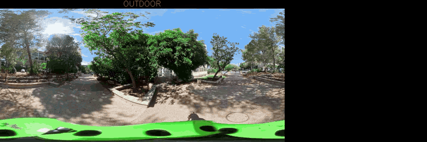
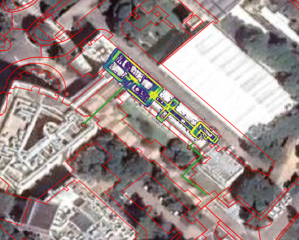

<h1 align="center">Indoor-Outdoor Spatial Mapping via 360-Degree Imaging</h1>

<h3 align="center">Continuous Transition Detection and Floor Plan Reconstruction</h3>

<p align="center">
  M.Sc. Thesis · Faculty of Civil and Environmental Engineering · Technion, Israel Institute of Technology
</p>

<p align="center">
  <b>Lital Efraim</b><br>
  Supervisor: Dr. Sagi Dalyot · Co-supervisor: Prof. Meead Saberi Kalaee (UNSW Sydney)<br>
  Research assistants: Raquel-Abdi Goldsztejn-Saad · Yuval Margolin
</p>

---

## Overview

Outdoor mapping relies on GNSS, while indoor mapping relies on SLAM and room layout models. At the building threshold, between these two regimes, localization and mapping reliability degrade, and indoor reconstruction models assume that capture starts inside a closed room. Continuous street-to-room capture therefore requires manual trimming before an indoor floor plan can be produced.

This research treats the indoor-outdoor threshold as a **continuous space-time interval** rather than a discrete class, and uses the detected entrance to **trigger floor plan reconstruction automatically** from a single 360° video walk.

The research has two components:

| Component | Question | Method |
|---|---|---|
| **A. Transition detection** | Where does the walk cross from street to building, and in which direction? | Three visual cues from pre-trained models (semantic, macro-structural, micro-feature), combined by a frame-level 2-of-3 vote |
| **B. Floor plan reconstruction** | How can the indoor portion become a continuous, metric 2D floor plan? | Transition gate, visual SLAM, layout estimation (HorizonNet and LGT-Net), scale alignment, wall and room extraction |

## From Street to Room

<p align="center">
  <a href="assets/street_to_room_demo.mp4">
    
  </a>
</p>

<p align="center"><i>
The trigger starts the map (campus video 089, shown at 3x speed; click for the full-speed video).
Outdoor: the gate is closed. Indoor: continuous mapping, keyframes accumulate and rooms close.
Outdoor again: the floor plan is locked. Entrance trigger at 0:13, exit trigger at 0:57.
</i></p>

<p align="center">
  
</p>

<p align="center"><i>
Linking street and room. Green: access paths; blue and yellow: indoor map.
</i></p>

The detected entrance links the two environments:

1. **The gate** shields the reconstruction network from false layouts estimated on sky and facades.
2. **The entrance node** is the point where the outdoor path meets the indoor map.
3. **Next stage:** georeferencing the indoor map at this node.

## Pipeline

```
360° video ──► Transition detection ──► Trigger ──► Floor plan reconstruction ──► 2D floor plan
               (3 cues, 2-of-3 vote)    (opens the    (SLAM, layout, scale,
                                          indoor gate)   walls, rooms)
```

### Component A: Multi-Cue Transition Detection

Each cue is computed per frame from a pre-trained model (no retraining) and reads the scene at a different spatial scale:

| Cue | Scale | Model | Indoor when |
|---|---|---|---|
| Macro-structural | Far: the building envelope | YOLOv7, Open Images V7 | A House or Building box covers more than 98% of the frame with confidence above 0.25 |
| Semantic | Mid: sky, vegetation, vehicle surfaces | 360SFUDA++ panoramic segmentation | Sky and vegetation below 5%, vehicles below 2% |
| Micro-feature | Near: individual objects | YOLOv7, Open Images V7 | Indoor objects (23 classes) are not outnumbered by outdoor objects (10 classes) |

A frame is labelled indoor when at least two of the three cues read indoor. Besides the state of every frame, the detector records the order in which the cues switch, which encodes the direction of motion.

### Component B: Transition-Aware Floor Plan Reconstruction

| Stage | Step |
|---|---|
| 0 | Transition gate: indoor ranges from Component A, with a 10-frame noise filter |
| 1 | Frames and camera poses from Stella-VSLAM (monocular, scale unknown) |
| 2 | Room layout estimation with HorizonNet and LGT-Net |
| 3 | Scale alignment to a single global scale |
| 4-5 | Wall extraction (RANSAC) and room closure |

Metric scale is anchored by the camera height: in an equirectangular frame, the distance to a floor point follows from `d = h / tan(θ)`, where `h` is the camera height and `θ` the pixel depression angle.

## Main Results

**Data.** 44 annotated crossings (22 entrances, 22 exits) in 34 videos from residential and campus sites; 8 indoor scenes reconstructed with two layout backbones (16 paired runs on identical poses).

- **A transition is an interval, not a point.** The median zone width is 2.65 s; 90% of crossings fall within 6.19 s (residential median 1.29 s, campus median 3.84 s).
- **Directional asymmetry.** The semantic cue responds first in 17 of 22 entrances and last in 22 of 22 exits, at both sites. The order of the cues encodes the direction of motion.
- **Robustness to temporal thinning.** 40 of 44 crossings are detected from the native frame rate down to 0.5 fps, with timing error rising from 0.76 s to 1.40 s.
- **Autonomous activation.** The entrance trigger starts reconstruction with no manual trimming of the video.
- **Gate stabilization preserves continuity.** On scene S1 the 10-frame filter yields 325 keyframes and 4 closed rooms, against 14 keyframes and 1 room without it; without the filter, 14 of 17 scenes lost keyframes.
- **Paired layout-model evaluation.** LGT-Net improved wall alignment to the building axes in 7 of 8 scenes, while scale-normalized IoU differed by less than 0.03 in 6 of 8 pairs. Shape agreement alone does not reveal layout failures.
- **Metric calibration.** With the camera height calibrated from the reference plan, scale error is within 2.7% on S3 and up to 9.1% on S2.

> **Note.** The detection thresholds were calibrated on the same corpus they were evaluated on (in-sample), and camera height was entered manually. Metric anchoring without a reference plan, an online quality gate, and GNSS integration are directions for future research.

## Related Repositories

The code of this research is published in three companion repositories, developed with the research assistants of the project:

| Repository | Content | Developer |
|---|---|---|
| [**raquelgold/indoor_outdoor_detection**](https://github.com/raquelgold/indoor_outdoor_detection) | Component A: indoor/outdoor transition detection in 360° video with the three cues and the 2-of-3 vote. Its output, `transitions_confirmed.csv`, is the input of the floor plan pipeline | Raquel-Abdi Goldsztejn-Saad |
| [**raquelgold/dfpe**](https://github.com/raquelgold/dfpe) | Component B: floor plans from 360° video. Cuts the video into indoor clips, estimates room layouts (HorizonNet or LGT-Net), tracks the camera with stella_vslam, and fuses both into a floor plan | Raquel-Abdi Goldsztejn-Saad |
| [**yuvalmar16/360SFUDA-Indoor-and-Outdoor-detection**](https://github.com/yuvalmar16/360SFUDA-Indoor-and-Outdoor-detection) | The semantic cue: 360° panoramic semantic segmentation (SegFormer adapted to equirectangular video) with a per-frame indoor/outdoor decision | Yuval Margolin |

## Publications

- L. Efraim, Y. Margolin, R.-A. Goldsztejn-Saad, M. Saberi Kalaee, S. Dalyot. *Directional Asymmetry in Indoor-Outdoor Transition Zones: A Tri-Cue 360-Degree Scene Analysis Framework.* Journal article, under review.
- L. Efraim, R.-A. Goldsztejn-Saad, Y. Margolin, M. Saberi Kalaee, S. Dalyot. *Transition-Aware Floor Plan Reconstruction from In-the-Wild 360° Video.* Journal article, under review.
- Poster, Cities and Complexity 2026, Tel Aviv University, 26.10.2026.

## Acknowledgments

This research builds on [HorizonNet](https://github.com/sunset1995/HorizonNet), [LGT-Net](https://github.com/zhigangjiang/LGT-Net), [direct_360_FPE](https://github.com/EnriqueSolarte/direct_360_FPE), [stella_vslam](https://github.com/stella-cv/stella_vslam), 360SFUDA++ and YOLOv7 with Open Images V7.

Thanks to research assistants Raquel-Abdi Goldsztejn-Saad and Yuval Margolin for the implementation of the companion repositories.
